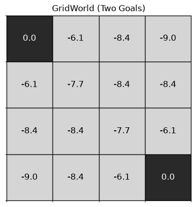
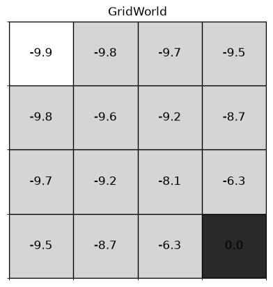
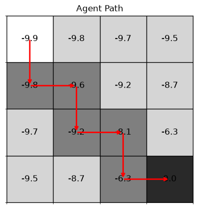
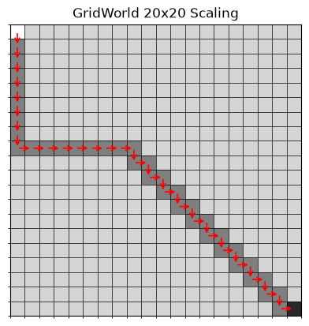

# RL GridWorld Bellman

Implementation of iterative policy evaluation and greedy path extraction for discrete GridWorld environments using NumPy and Matplotlib.

## Overview

This repository demonstrates dynamic programming applied to a finite Markov Decision Process based on Chapter 4 of Sutton and Barto's *Reinforcement Learning: An Introduction*. The environment consists of a 2D grid where an agent evaluates state values under an equiprobable random policy and determines the shortest route to a designated terminal goal.

The environment accepts arbitrary grid dimensions $x \times y$, allowing users to configure boards of any rectangular size.

## Problem Formulation

### Markov Decision Process
The navigation task is formulated as a discrete MDP defined by the tuple $(S, A, P, R, \gamma)$:

- **State Space $S$**: Grid cells indexed by matrix coordinates $(r, c)$ where $r \in \{0, \dots, N-1\}$ and $c \in \{0, \dots, M-1\}$. In the default configuration, $N = 4$ and $M = 4$, yielding 16 states.
- **Action Space $A$**: Four cardinal deterministic displacements:
  - $\text{Up}: (-1, 0)$
  - $\text{Down}: (1, 0)$
  - $\text{Left}: (0, -1)$
  - $\text{Right}: (0, 1)$
- **Transition Dynamics $P$**: Deterministic state transitions. If an action would push the agent across grid boundaries, the agent remains in its current state.
- **Reward Function $R$**: A constant step penalty of $r = -1$ on all transitions until reaching a goal state.
- **Discount Factor $\gamma$**: Undiscounted episodic formulation with $\gamma = 1.0$.
- **Terminal States**:
  - **Sutton and Barto Benchmark**: Two terminal absorbing states at top-left $(0, 0)$ and bottom-right $(3, 3)$ with boundary condition $V(0, 0) = V(3, 3) = 0$.
  - **Single Goal Mode**: Designated start at $(0, 0)$ and a single destination goal at $(3, 3)$ with boundary condition $V(3, 3) = 0$.

### Bellman Expectation Equation
State values are evaluated under a uniform random policy $\pi(a \mid s) = 0.25$ using the Bellman expectation backup:

$$
V_{k+1}(s) = \sum_{a \in A} \pi(a \mid s) \left[ r + \gamma V_k(s') \right] = \frac{1}{4} \sum_{a \in A} \left[ -1 + \gamma V_k(s') \right]
$$

### Greedy Policy Extraction
Once state values are computed, the agent follows a greedy policy with respect to $V(s)$ by selecting the neighboring state with the highest expected value:

$$
a^*(s) = \arg\max_{a \in A} V(s')
$$

## Results

### Sutton and Barto Benchmark: Two Terminal States
Following the classic formulation from Example 4.1 in the textbook, terminal absorbing goals are placed at $(0, 0)$ and $(3, 3)$. After $k = 10$ sweeps of iterative policy evaluation, the computed value surface displays symmetry across the anti-diagonal.

### State-Value Function: Single Goal
In this setup, $(0, 0)$ serves as the starting point and $(3, 3)$ represents the sole target destination. Evaluated state values decrease with Manhattan distance from the goal, creating a direct gradient toward $(3, 3)$.

### Agent Greedy Trajectory
Starting at $(0, 0)$, the greedy policy follows the value gradient toward $(3, 3)$ while handling boundary collisions. Directional arrows indicate the sequence of executed steps until reaching the destination.

### Arbitrary Grid Dimensions
The grid size is fully customizable. For instance, evaluating a $20 \times 20$ grid with 400 states using $k = 60$ iterations produces a smooth value gradient and extracts a 38-step greedy path from $(0, 0)$ to $(19, 19)$.

## References

- Sutton, R. S., and Barto, A. G. (2018). *Reinforcement Learning: An Introduction*. Second edition. MIT Press. Chapter 4: Dynamic Programming.
